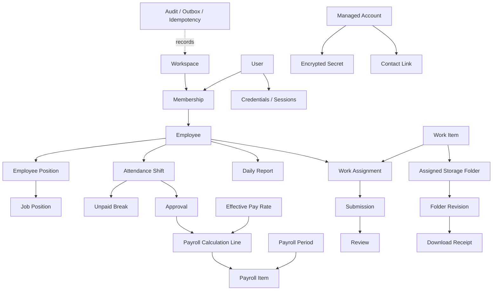

# Data Flow / ER Overview

Flow: Staff request → secure session → workspace RBAC → module-owned transaction in PostgreSQL → audit + outbox where needed → asynchronous provider operation (email/Drive) → reconciliation → UI reads actual status. Redis may accelerate reads but never be authoritative. Secret keys outside DB; staff cannot access managed account secrets.
