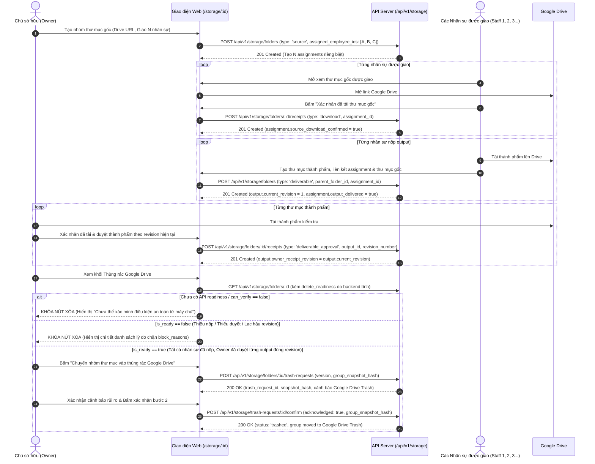

# SCOPE-EXT-05: FILE-01 (Quản lý Tệp & Thư mục Google Drive - V0.2 / Canonical STORAGE)

> **Trạng thái:** DRAFT & READY FOR REVIEWER CONFIRMATION (2026-10-09)  
> **Phiên bản:** `0.2.0-ext.05-rev02` (Bổ sung kiểm soát từng Assignment, Output Revision và Backend Delete-Readiness)  
> **Phụ trách:** Anti (Frontend UI & Shared Contracts), Backend theo phân công  
> **Module Canonical:** `STORAGE` (Nhãn UI hiển thị: **"Tệp & Drive"**)  
> **Tuyến đường giao diện:** `/storage` (UI-STORAGE-01) và `/storage/:id` (UI-STORAGE-02)  
> **Nhánh thực hiện:** `feat/v0.2-file-web`  
> **Baseline:** `27cabf9453bff79d1c4caff82a6424bbb0ce4a94` (chứa đầy đủ WORK, PAY, ACC)

---

## 1. Bối cảnh & Căn cứ Pháp lý Canonical (STORAGE)

1. **Khung thẩm quyền Canonical:**
   - `02_MODULE_REGISTRY.md`: Module `STORAGE` sở hữu các thực thể `storage_folders`, `storage_files`, `folder_revisions`, `folder_receipts`, `storage_operations`, `resource_access_grants`. Phụ thuộc vào `WORK assignments` và `WORK submissions`.
   - `03_DATA_DICTIONARY.md`:
     - `storage_folders`: `id, workspace_id, provider, provider_folder_id, status, current_revision_id`.
     - `storage_files`: `id, workspace_id, folder_id, provider_file_id, provider_revision_id, status`.
     - `folder_revisions`: `id, workspace_id, folder_id, revision_number, snapshot_hash, created_at`.
     - `folder_receipts`: `id, workspace_id, folder_revision_id, confirmed_by, confirmed_at, receipt_type`.
     - `storage_operations`: `id, workspace_id, folder_id, operation_type, status, requested_by, created_at`.
     - `resource_access_grants`: Phân quyền theo tài nguyên (Owner vs Nhân sự được giao).
   - `05_API_CONTRACTS.md`:
     `STORAGE: GET/POST /storage/folders; GET /storage/folders/{id}/files; POST /storage/folders/{id}/receipts, /storage/folders/{id}/trash-requests, /storage/trash-requests/{id}/confirm; GET /storage/operations/{id}.`
   - `26_APIREADY_STATE_CONCURRENCY_AND_EXTERNAL.md` (Dòng 14 & 17):
     - _"Trash vs folder revision change => no provider trash if receipt stale."_
     - _"Owner Trash requires version precondition, two-step confirmation, latest receipt and ACL recheck. Worker ambiguous timeout => unknown, not completed."_
   - `45_UIREVIEW_SCREEN_AND_ROUTE_MATRIX.md`: Giao diện Drive/STORAGE thuộc phạm vi mở rộng V0.2.

2. **Đối chiếu Xung đột (Conflict Resolution):**
   - **Đánh giá:** KHÔNG CÓ XUNG ĐỘT với tài liệu chuẩn tắc Canonical.
   - Cơ chế kiểm soát theo từng Assignment nhân sự, từng Output thành phẩm kèm Revision và kiểm tra `delete-readiness` từ Backend bảo đảm tuyệt đối quy tắc của Doc 26 dòng 14: _"Trash vs folder revision change => no provider trash if receipt stale"_.

---

## 2. Quy trình Nghiệp vụ Chi tiết Từng Assignment & Output

---

## 3. Quy tắc Khóa Chặn Xóa An Toàn Nghiêm Ngặt (Strict Deletion Invariants)

Hệ thống TUYỆT ĐỐI KHÔNG tự kết luận điều kiện xóa từ 3 cờ tổng hợp ở phía giao diện. Quyền quyết định chuyển vào thùng rác Google Drive hoàn toàn do Backend tính toán (`delete_readiness`) dựa trên các ràng buộc:

1. **Kiểm tra từng Assignment Nhân sự (`assignments`):**
   - Mọi nhân sự trong danh sách phân công đều phải xác nhận đã tải nguồn (`source_download_confirmed == true`).
   - Mọi nhân sự trong danh sách phân công đều phải bàn giao output thành phẩm (`output_delivered == true`). Nếu có 3 nhân sự được giao mà chỉ 1 hoặc 2 người nộp => BỊ CHẶN XÓA (Block: Partial Delete).
2. **Kiểm tra từng Output Thành phẩm (`outputs`):**
   - Mọi output phải có biên nhận Owner receipt (`owner_receipt_confirmed == true`). Nếu có 3 output mà chỉ 2 output được duyệt => BỊ CHẶN XÓA.
3. **Kiểm tra Khớp Revision Hiện tại (`current_revision == owner_receipt_revision`):**
   - Nếu một output sau khi được Owner duyệt bị nhân viên cập nhật/sửa đổi (tăng revision từ v1 lên v2) mà Owner chưa duyệt lại revision mới => Biên nhận cũ bị coi là LẠC HẬU (`stale_output_revisions > 0`) => BỊ CHẶN XÓA theo quy tắc Doc 26: _"Trash vs folder revision change => no provider trash if receipt stale"_.
4. **Bảo vệ Tính toàn vẹn Concurrency (`group_snapshot_hash` & `If-Match`):**
   - Cả bước tạo yêu cầu xóa (`trash-requests`) lẫn xác nhận xóa (`confirm`) đều bắt buộc truyền `group_snapshot_hash` tổng hợp trạng thái của toàn bộ nhóm thư mục. Nếu có thay đổi bất kỳ trên assignment hoặc output trong thời gian này, thao tác bị từ chối (412 Precondition Failed).
5. **Khóa An Toàn khi API Chưa Sẵn Sàng (Fail-Closed UX):**
   - Nếu máy chủ chưa cung cấp `delete_readiness` hoặc không thể kết nối, giao diện KHÔNG tự suy đoán mà tự động đưa nút xóa vào trạng thái KHÓA AN TOÀN và thông báo rõ _"Chưa thể xác minh điều kiện xóa từ máy chủ"_.
6. **Thuật ngữ Chuẩn xác:**
   - Dùng thuật ngữ **"Chuyển vào thùng rác Google Drive (Google Drive Trash)"**, không gọi là xóa vĩnh viễn, vì tệp chuyển vào thùng rác trên Google Drive có thể được khôi phục hoặc xóa hẳn theo chính sách lưu trữ của Google Workspace.

---

## 4. Danh mục Hợp đồng API Chuẩn

- `GET /api/v1/storage/folders`: Danh sách nhóm thư mục (Owner xem toàn bộ, Staff xem thư mục được phân công).
- `POST /api/v1/storage/folders`: Tạo thư mục gốc (Owner) hoặc tạo thư mục thành phẩm liên kết assignment (Staff).
- `GET /api/v1/storage/folders/:id`: Chi tiết nhóm thư mục, bao gồm:
  - `assignments`: Mảng từng nhân viên kèm trạng thái tải nguồn và trạng thái bàn giao output.
  - `outputs`: Mảng từng thư mục thành phẩm kèm `current_revision` và `owner_receipt_revision`.
  - `delete_readiness`: Đối tượng đánh giá đủ điều kiện xóa do backend tính.
- `POST /api/v1/storage/folders/:id/receipts`: Ghi nhận biên nhận tải nguồn hoặc duyệt thành phẩm theo revision.
- `POST /api/v1/storage/folders/:id/trash-requests`: Khởi tạo yêu cầu chuyển vào thùng rác Google Drive kèm `group_snapshot_hash`.
- `POST /api/v1/storage/trash-requests/:id/confirm`: Xác nhận chuyển nhóm thư mục vào Google Drive Trash.
